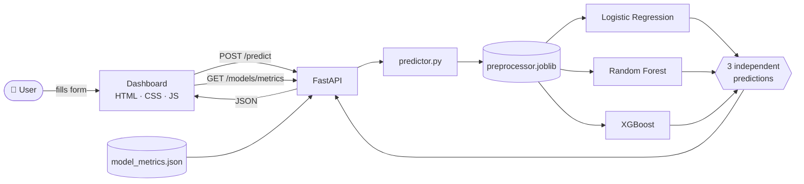
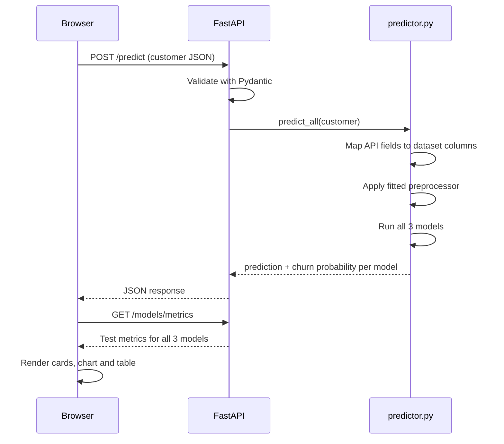
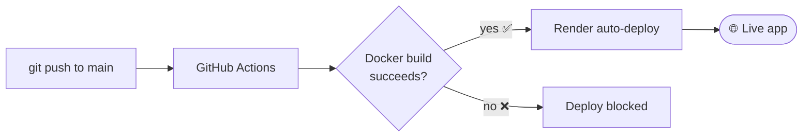

<div align="center">

# 🛡️ ChurnGuard

### Three machine learning models. One customer. Independent churn verdicts.

[](https://github.com/priyanshu6704/customer_churn/actions/workflows/ci.yml)


**[🚀 Live Demo](https://customer-churn-az5b.onrender.com)**  · **[🐛 Report a Bug](https://github.com/priyanshu6704/customer_churn/issues)**

> ⏳ The demo runs on a free Render instance, which sleeps after 15 minutes idle.
> The first visit after a break can take about a minute to wake up.

</div>

---

## 📌 Overview

**ChurnGuard** predicts whether a bank customer is likely to leave, and shows how
three independently trained models judge the **same** customer side by side.

Instead of crowning a single "best" model, ChurnGuard keeps all three available.
Each model has different strengths (see the metrics below), so you can compare
their verdicts and probabilities for every customer you enter.

| | |
|---|---|
| **Problem** | Binary classification: will the customer churn (`Exited = 1`)? |
| **Models** | Logistic Regression · Random Forest · XGBoost |
| **Serving** | FastAPI backend serving a vanilla HTML/CSS/JS dashboard |
| **Tracking** | MLflow experiment `ChurnGuard` |
| **Delivery** | Docker image · GitHub Actions CI · Render deployment |

---

## ✨ Features

- 🧠 **Three independent predictions** per customer, with churn probability from each model
- 📊 **Model comparison dashboard**: ROC-AUC chart plus a full metrics table (Chart.js)
- 🧾 **Validated input**: Pydantic rejects out-of-range values with a clear error
- ⚡ **No retraining at inference**: saved preprocessor and models are loaded once at startup
- 🧪 **Experiment tracking** with MLflow across all three models
- 🐳 **Containerised** and checked by CI on every push
- 📱 **Responsive** olive-and-black UI that works on desktop and mobile

---

## 🏗️ Architecture



<details>
<summary><b>🔁 Request flow (click to expand)</b></summary>



</details>

---

## 📈 Model Performance

Evaluated on a held-out **15% test set** (split: 70% train / 15% validation / 15% test,
`random_state=42`).

| Model | ROC-AUC | Accuracy | Precision | Recall | F1 |
|---|---|---|---|---|---|
| Logistic Regression | 0.8145 | 0.7543 | 0.4502 | 0.7295 | 0.5568 |
| Random Forest | — | — | — | — | — |
| XGBoost | 0.8876 | 0.8650 | 0.7468 | 0.5479 | 0.6321 |

> 🔄 The Random Forest was re-tuned (`max_depth`, `min_samples_leaf`) so its file fits
> inside Render's free 512 MB memory limit. Fill in its row from
> [`reports/model_metrics.json`](reports/model_metrics.json), which is the single source of truth.

**How to read this:** Logistic Regression catches the most churners (highest recall) but
raises more false alarms. XGBoost is the most precise and has the best ROC-AUC. That
trade-off is the reason all three models stay available.

---

## 🧰 Tech Stack

| Layer | Tools |
|---|---|
| Data & ML | Pandas · NumPy · scikit-learn · XGBoost · Joblib |
| Tracking | MLflow |
| Backend | FastAPI · Pydantic · Uvicorn |
| Frontend | HTML · CSS · JavaScript · Chart.js |
| DevOps | Docker · GitHub Actions · Render |

---

## 📁 Project Structure

```
customer_churn/
├── .github/workflows/
│   └── ci.yml                 # CI: builds the Docker image on every push
├── app/
│   ├── main.py                # FastAPI app and endpoints
│   ├── predictor.py           # Loads artifacts, runs the 3 models
│   ├── schemas.py             # Pydantic request/response models
│   └── static/
│       ├── index.html         # Dashboard
│       ├── style.css          # Olive & black theme
│       └── script.js          # Fetch API, rendering, Chart.js
├── src/
│   ├── config.py              # Paths to models and preprocessor
│   ├── preprocess.py          # Data loading and preprocessing
│   ├── train.py               # Trains the three models
│   └── evaluate.py            # Evaluates models, writes model_metrics.json
├── models/                    # Saved preprocessor and 3 trained models
├── reports/
│   └── model_metrics.json     # Test metrics read by the dashboard
├── notebooks/                 # EDA and model training notebooks
├── data/                      # Dataset (not tracked in Git)
├── Dockerfile
├── .dockerignore
├── requirements.txt
└── IMPLEMENTATION.md          # Phase-by-phase build log
```

---

## 🚀 Getting Started

### Option 1: Run locally

```bash
# 1. Clone
git clone https://github.com/priyanshu6704/customer_churn.git
cd customer_churn

# 2. Create and activate a virtual environment
python -m venv venv
source venv/bin/activate        # Windows: venv\Scripts\activate

# 3. Install dependencies
pip install -r requirements.txt

# 4. Start the server
uvicorn app.main:app --reload
```

Open **http://127.0.0.1:8000/**.

> ⚠️ Always open the app through the FastAPI address. Opening `index.html` directly
> or through a static preview server will not work, because the API lives on the same server.

### Option 2: Run with Docker

```bash
docker build -t churnguard .
docker run -p 8000:8000 churnguard
```

Open **http://127.0.0.1:8000/**.

### Rebuild the models (optional)

```bash
python -m src.train       # trains and saves the three models
python -m src.evaluate    # prints metrics and writes reports/model_metrics.json
```

The dataset must be at `data/bank_churn.csv`.

---

## 🔌 API Reference

| Method | Endpoint | Description |
|---|---|---|
| `GET` | `/` | Serves the dashboard |
| `GET` | `/health` | Health check |
| `POST` | `/predict` | Predictions from all three models |
| `GET` | `/models/metrics` | Test metrics for model comparison |
| `GET` | `/docs` | Interactive Swagger UI |

<details>
<summary><b>📥 Example request</b></summary>

```json
POST /predict
{
  "credit_score": 500,
  "country": "Spain",
  "gender": "Male",
  "age": 40,
  "tenure": 5,
  "balance": 25000,
  "products_number": 2,
  "credit_card": 1,
  "active_member": 1,
  "estimated_salary": 60007
}
```

</details>

<details>
<summary><b>📤 Example response</b></summary>

```json
{
  "logistic_regression": { "prediction": 0, "churn_probability": 0.1431, "result": "Unlikely to Churn" },
  "random_forest":       { "prediction": 0, "churn_probability": 0.165,  "result": "Unlikely to Churn" },
  "xgboost":             { "prediction": 0, "churn_probability": 0.0333, "result": "Unlikely to Churn" }
}
```

*Sample values for illustration. Real output depends on the input and the trained models.*

</details>

<details>
<summary><b>🧾 Input validation rules</b></summary>

| Field | Type | Allowed |
|---|---|---|
| `credit_score` | int | 300 – 900 |
| `country` | string | France, Germany, Spain |
| `gender` | string | Male, Female |
| `age` | int | 18 – 100 |
| `tenure` | int | 0 – 10 |
| `balance` | float | ≥ 0 |
| `products_number` | int | 1 – 4 |
| `credit_card` | int | 0 or 1 |
| `active_member` | int | 0 or 1 |
| `estimated_salary` | float | ≥ 0 |

Invalid input returns `422` with the failing field.

</details>

---

## 🔄 CI/CD



- **CI** (`.github/workflows/ci.yml`): builds the Docker image on every push and pull request. A broken
  requirements file, a missing model file or a bad Dockerfile fails the check.
- **CD**: Render deploys the same Docker image from `main`.

---

## 🧠 Design Decisions

- **No single "winner" model.** Each model trades precision against recall differently, so all three are
  served and compared rather than one being hard-coded.
- **Models are baked into the Docker image.** The app loads them at startup, so the image that passed CI is
  the exact one that runs in production.
- **Random Forest size is constrained on purpose.** Unrestricted trees produced a model of hundreds of MB, which
  exceeded GitHub's file limit and Render's free-tier memory. `max_depth` and `min_samples_leaf` cap it.
- **Metrics come from code, not by hand.** `src/evaluate.py` writes `model_metrics.json`, so a model change and
  its metrics always update together.
- **One service, not two.** FastAPI serves both the API and the static frontend, so there is no CORS setup and no
  second deployment.

---

## 🗺️ Roadmap

- [ ] Prediction history stored in SQLite
- [ ] Threshold slider to trade precision for recall
- [ ] Feature-importance view per model
- [ ] Automated API tests in CI

---

## 👤 Author

**Priyanshu** · [@priyanshu6704](https://github.com/priyanshu6704)

---

<div align="center">

If this project helped you, consider giving it a ⭐

</div>
